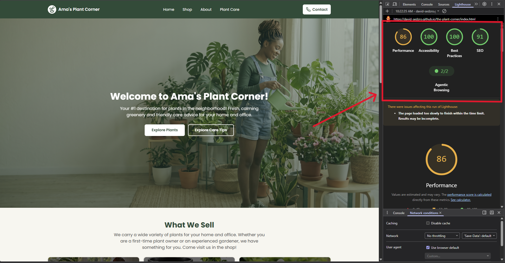
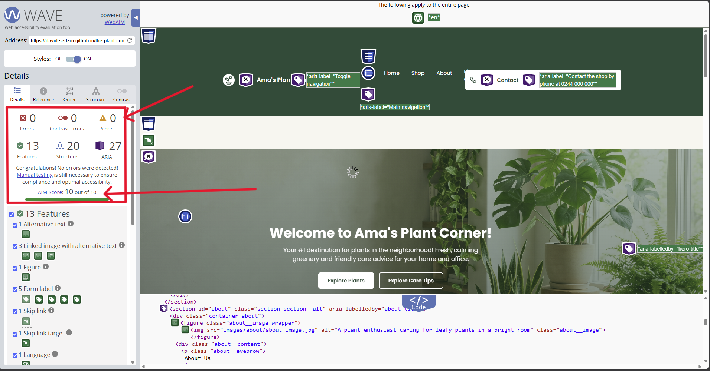
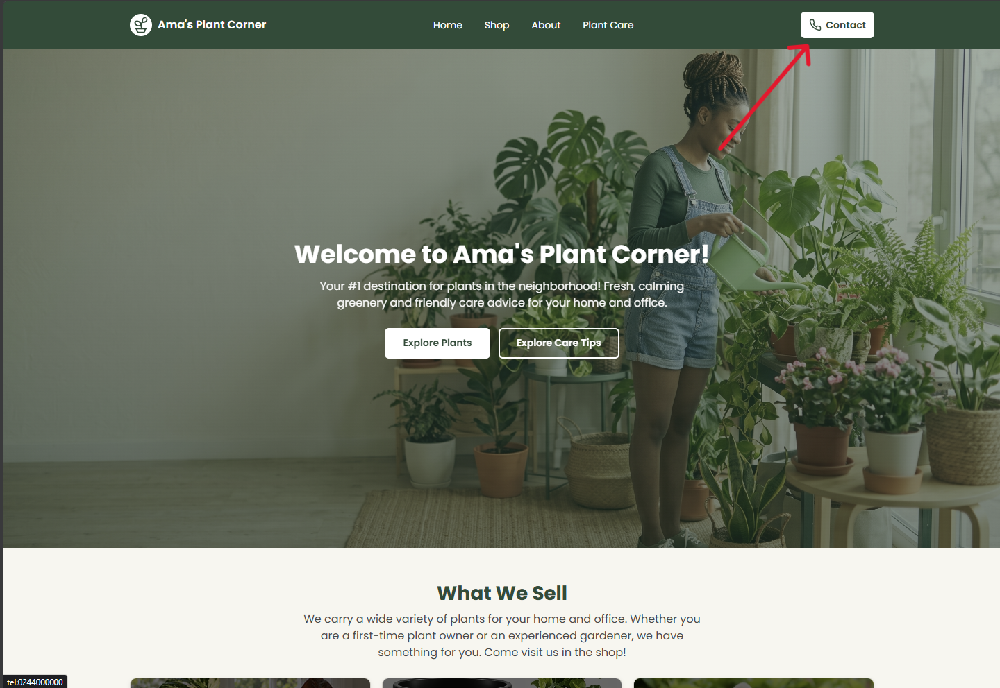
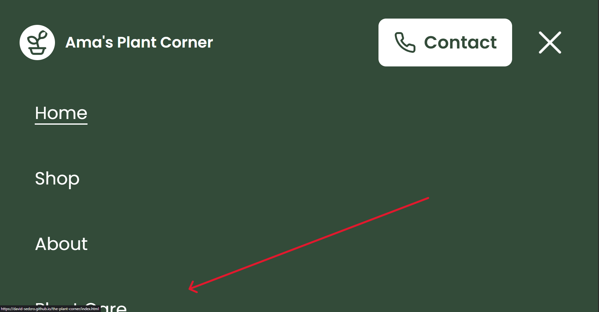
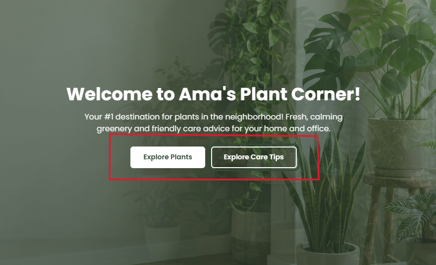
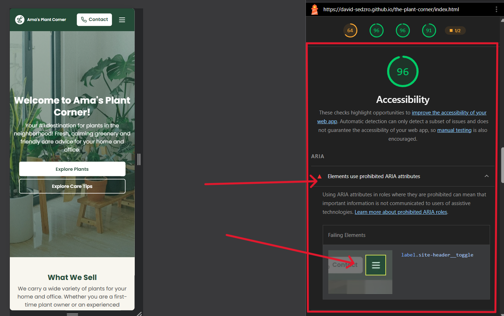
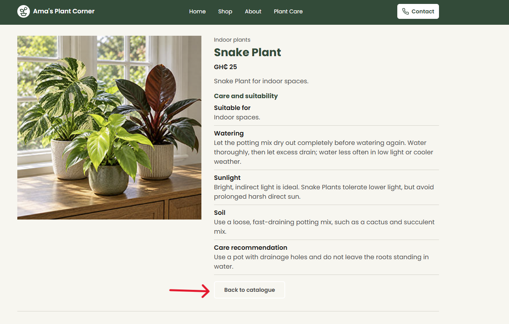
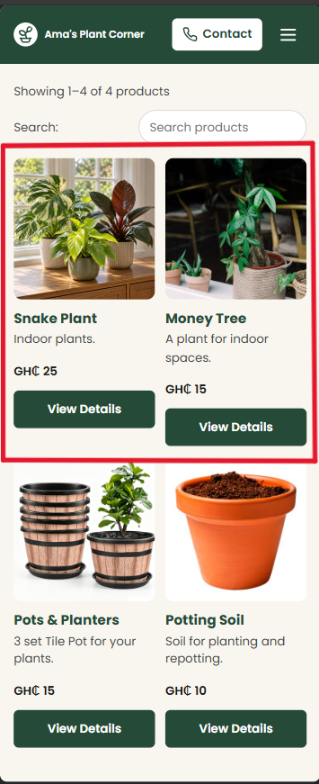

# Accessibility audit: Ama's Plant Corner site by David Sedzro

- **Site audited:** [Ama's Plant Corner](https://david-sedzro.github.io/the-plant-corner/).
- **Date and time tested:** 18th November 2026.
- **Audited by:** Alvin Etornam Laryea.
- **Standard:** WCAG 2.2, Level AA.

## How I tested

- **Automated tools:** Google Lighthouse (Accessibility Audit). WAVE testing should be recorded once completed.
- **Keyboard:** Manual keyboard navigation using the Tab key to examine navigation links and hero section buttons, including their visible focus states.
- **Zoom, text size and reflow:** Browser zoom testing at 400%. Responsive layout inspection at viewport widths of 375px and below.
- **Screen reader:** Microsoft Edge Read Aloud tool.
- **Pages and journeys covered:**
  - Homepage – Navigation bar.
  - Homepage – Hero section.
  - Shop page – Plants and Accessories.
  - Product details page.
  - Navigation menu toggle.
  - Contact Us page – Contact form.

## Summary

The accessibility assessment produced positive results during automated desktop testing. WAVE recorded an accessibility score of 10/10 with no errors, while Google Lighthouse recorded an accessibility score of 100%.

However, mobile testing using Google Lighthouse identified one accessibility issue, resulting in a score of 96%.

In addition to the automated findings, manual testing identified potential accessibility barriers involving keyboard focus visibility, navigation behaviour at 400% zoom, button border contrast and form field identification. These issues demonstrate that a high automated accessibility score does not necessarily mean that a website is fully accessible.

The findings below are arranged according to their potential impact on users and the importance of addressing them.

## Findings, in priority order

| Finding                                                                 | Ranking | Severity         |
| ----------------------------------------------------------------------- | ------: | ---------------- |
| Navigation link has no visible keyboard focus indicator                 |       1 | High             |
| Navigation menu clips the last navigation link at 400% zoom             |       2 | High             |
| Hero section buttons have poorly visible keyboard focus indicators      |       3 | High             |
| Contact Us form does not identify required fields before submission     |       4 | Medium–High      |
| Navigation menu toggle uses prohibited ARIA attributes                  |       5 | Medium–High      |
| Insufficient contrast on the "Back to Catalogue" button border          |       6 | Medium           |
| Shop page layout requires further investigation at smaller screen sizes |       7 | To be determined |

### 1. Navigation link has no visible keyboard focus indicator

**Priority: High**

- **Where:** Homepage > Navigation bar > Contact button/link.
- **What happens:** When navigating the website using a keyboard, the Contact button in the navigation bar does not display a visible focus indicator. Its focused appearance is either missing or indistinguishable from its normal appearance. This makes it difficult for keyboard users to identify which navigation item currently has focus.
- **How to reproduce:**
  1. Open the website homepage.
  2. Use the `Tab` key to navigate through the navigation bar.
  3. Continue pressing `Tab` until the Contact button receives keyboard focus.
  4. Observe the appearance of the Contact button.
  5. Notice that there is no clearly distinguishable visual change indicating that the button is focused.
- **Evidence:**
  
- **Principle and criterion:** Operable; WCAG 2.4.7 – Focus Visible (Level AA).
- **Who it affects and how:** Keyboard-only users and people with motor disabilities who rely on keyboard navigation may have difficulty identifying their current position within the navigation menu. This can make navigating the website confusing and less predictable.
- **Found by:** Manual keyboard testing.
- **Why it ranks here:** This is a high-priority issue because visible focus indicators are essential for keyboard users to understand where they are on a webpage. Without a visible indicator, users may struggle to navigate the website confidently and identify the control they are about to activate.

### 2. Navigation menu clips the last navigation link at 400% zoom

**Priority: High**

- **Where:** Homepage – Navigation bar – Navigation dropdown/menu.
- **What happens:** When the browser zoom level is increased to 400%, the navigation dropdown clips its last navigation link. As a result, the complete navigation content is not visible, potentially preventing users from accessing the affected link.
- **How to reproduce:**
  1. Open the website homepage.
  2. Increase the browser zoom level to 400%.
  3. Open or inspect the navigation dropdown.
  4. Observe the navigation links.
  5. Notice that the last navigation link is clipped and cannot be viewed completely.
- **Evidence:**

  Screenshot showing the navigation dropdown at 400% zoom and the clipped navigation link.
  

- **Principle and criterion:** Perceivable; WCAG 1.4.10 - Reflow (Level AA).
- **Who it affects and how:** People with low vision who increase browser zoom to make website content larger may be unable to view or access all navigation links. This can prevent them from reaching important sections of the website.
- **Found by:** Manual browser zoom testing.
- **Why it ranks here:** This is a high-priority issue because it affects access to website navigation at high zoom levels. Users who depend on magnification may be prevented from accessing important sections of the website. The issue also relates directly to the WCAG reflow requirement.

### 3. Hero section buttons have poorly visible keyboard focus indicators

**Priority: High**

- **Where:** Homepage – Hero section – Call-to-action (CTA) buttons.
- **What happens:** When navigating the hero section using the keyboard, the CTA buttons display a focus indicator in the form of a border. However, the border has insufficient visual contrast against the background image, making it difficult to distinguish the focused state from the normal appearance of the buttons.
- **How to reproduce:**
  1. Open the website homepage.
  2. Use the `Tab` key to navigate through the page.
  3. Continue until one of the hero section CTA buttons receives focus.
  4. Observe the border displayed around the focused button.
  5. Notice that the border is difficult to distinguish against the background image.
- **Evidence:**

  Screenshot showing the CTA button's focus indicator against the hero background.

  

- **Principle and criterion:** Operable; WCAG 2.4.7 – Focus Visible (Level AA). Perceivable; WCAG 1.4.11 – Non-text Contrast (Level AA), where the focus indicator fails the required contrast threshold.
- **Who it affects and how:** Keyboard-only users and people with low vision may struggle to identify which CTA button currently has keyboard focus. This makes it more difficult to interact with important actions on the homepage.
- **Found by:** Manual keyboard testing.
- **Why it ranks here:** This is a high-priority issue because the hero section contains important calls to action. If users cannot clearly identify which button has focus, they may struggle to interact with these controls.

### 4. Contact Us form does not identify required fields before submission

**Priority: Medium–High**

- **Where:** Contact Us page – Contact form.
- **What happens:** The contact form does not clearly identify which fields are required before users attempt to submit it. As a result, users may not know which information they must provide to complete the form successfully. They may only discover that certain fields are mandatory after attempting to submit the form.
- **How to reproduce:**
  1. Open the website homepage.
  2. Navigate to the Contact Us page.
  3. Locate the contact form.
  4. Inspect the form fields before entering any information.
  5. Observe whether required fields are visually identified or accompanied by instructions.
  6. Attempt to submit the form without completing the required fields.
  7. Observe whether the website only communicates the required fields after submission.
- **Evidence:**

  Screenshot showing the Contact Us form and the required fields that are not identified before submission.

- **Principle and criterion:** Understandable; WCAG 3.3.2 – Labels or Instructions (Level A). WCAG 3.3.1 – Error Identification (Level A) may also be relevant if submission errors are not properly identified.
- **Who it affects and how:** People with cognitive disabilities, learning difficulties and users who rely on assistive technologies may have difficulty understanding which information is mandatory. This can lead to confusion, unnecessary submission attempts and difficulty completing the contact form.
- **Found by:** Manual form inspection and submission testing.
- **Why it ranks here:** This is a medium–high priority issue because unclear form requirements can make it difficult for users to complete an important website interaction. Identifying required fields before submission helps users understand what information is expected and reduces avoidable errors.

### 5. Navigation menu toggle uses prohibited ARIA attributes

**Priority: Medium–High**

- **Where:** Website header – Navigation menu toggle (`label.site-header__toggle`).
- **What happens:** The navigation menu toggle uses an ARIA attribute that is prohibited for the element's assigned role. This can cause assistive technologies, such as screen readers, to misinterpret or fail to communicate the element's purpose correctly to users.
- **How to reproduce:**
  1. Open the website in a browser.
  2. Open browser Developer Tools.
  3. Navigate to the Lighthouse tab.
  4. Run an accessibility audit.
  5. Locate the "Elements use prohibited ARIA attributes" warning.
  6. Identify `label.site-header__toggle` under the failing elements.
- **Evidence:**

  Screenshot of the Lighthouse accessibility warning showing the failing element.

  

- **Principle and criterion:** Robust; WCAG 4.1.2 – Name, Role, Value (Level A), if the incorrect ARIA usage prevents the control's name, role or state from being correctly exposed to assistive technologies.
- **Who it affects and how:** People who use screen readers and other assistive technologies may not receive accurate information about the menu toggle's role or purpose. This can make it difficult to understand and interact with the website's navigation menu.
- **Found by:** Google Lighthouse – Accessibility Audit.
- **Why it ranks here:** This issue may affect how assistive technologies interpret an important navigation control. It is ranked below the directly observed keyboard focus, zoom and form issues because the precise ARIA attribute and its effect on the accessibility tree still need to be confirmed through HTML inspection and screen reader testing.

### 6. Insufficient contrast on the "Back to Catalogue" button border

**Priority: Medium**

- **Where:** Product details page – Back to Catalogue button.
- **What happens:** The border surrounding the Back to Catalogue button does not provide sufficient contrast against its background. This makes the boundary of the button difficult to distinguish, particularly for users with low vision.
- **How to reproduce:**
  1. Open the website homepage.
  2. Navigate to the Shop page using the navigation bar.
  3. Scroll through the available products.
  4. Select the View Details button on any product.
  5. On the product details page, locate the Back to Catalogue button.
  6. Observe the contrast between the button border and its surrounding background.
- **Evidence:**

  Screenshot showing the Back to Catalogue button and its surrounding background.

  

- **Principle and criterion:** Perceivable; WCAG 1.4.11 – Non-text Contrast (Level AA).
- **Who it affects and how:** People with low vision or visual impairments may have difficulty distinguishing the button from its background. This can make the button's boundaries and interactive nature less apparent.
- **Found by:** Manual visual inspection.
- **Why it ranks here:** This is a medium-priority issue because it affects the visibility of an interactive component. However, its impact is more limited than issues that prevent users from navigating the website or accessing important content. The actual contrast ratio should be measured to confirm the failure against the WCAG 1.4.11 requirement.

### 7. Shop page layout requires further investigation at smaller screen sizes

**Priority: To be determined**

- **Where:** Shop page – Plants and Accessories section.
- **What happens:** The Shop page was inspected at a mobile viewport width of 375px and below. However, the specific layout or accessibility problem observed has not yet been documented. Further inspection is required to determine whether content is clipped, overlaps, becomes difficult to read or requires unnecessary horizontal scrolling.
- **How to reproduce:**
  1. Open the website homepage.
  2. Navigate to the Shop page using the navigation bar.
  3. Open browser Developer Tools.
  4. Enable the responsive device toolbar.
  5. Set the viewport width to 375px or below.
  6. Inspect the Plants and Accessories section.
  7. Observe the layout and check for content overflow, overlapping elements or inaccessible controls.
- **Evidence:**

  Screenshot of the Shop page at 375px or below.

  

- **Principle and criterion:** Perceivable; WCAG 1.4.10 – Reflow (Level AA), if the inspection confirms that content is clipped, requires two-dimensional scrolling where it should reflow, or becomes unavailable.
- **Who it affects and how:** Mobile users and people with low vision who use screen magnification may experience difficulty accessing content if the layout does not adapt properly to smaller screen sizes.
- **Found by:** Manual responsive viewport testing using browser Developer Tools.
- **Why it ranks here:** Its priority cannot be reliably determined until the actual problem is identified. Responsive layout problems can significantly affect mobile users, particularly if important content or controls become inaccessible. The finding should be updated once the specific issue is confirmed.

## What works well

The following areas have not yet been sufficiently tested to confirm whether they meet accessibility requirements.

- The website's overall navigation and page structure.
- Alternative text for meaningful images.
- Form labels and accessible names.
- Heading hierarchy and content structure.
- Keyboard accessibility of interactive elements beyond the issues documented above.
- Text colour contrast throughout the website.

## Not tested, and limits of this audit

- **Screen reader testing:** Microsoft Edge's Read Aloud feature was used to assess how the website's textual content is presented through audio, helping to determine whether information such as plant care guides and other content could be easily followed when read aloud. However, Read Aloud is a text-to-speech feature rather than a fully featured screen reader. It does not provide the same level of interaction, keyboard navigation or accessibility announcements as dedicated screen readers such as NVDA or JAWS. Therefore, this test does not constitute a complete screen-reader accessibility assessment.
- **Automated testing limitations:** Lighthouse identifies potential accessibility problems but cannot detect every accessibility issue. Manual testing is necessary to establish the actual impact on users.

**Overall recommendation:** The website should prioritise fixing the keyboard focus visibility and navigation reflow issues, followed by improving the identification of required contact form fields and reviewing the navigation menu's ARIA implementation. Further manual testing should be carried out to identify any additional accessibility barriers.
